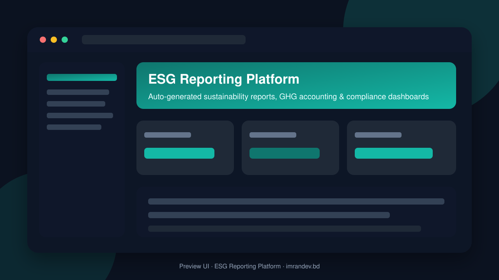
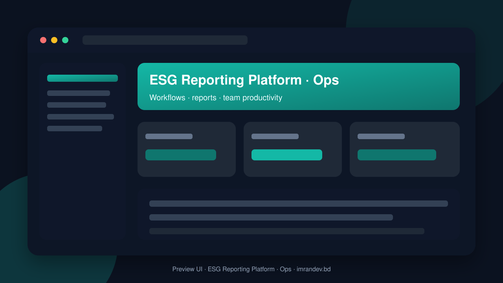

<p align="center">
  
</p>

# ESG Reporting Platform

<p align="center"><strong>Auto-generated sustainability reports, GHG accounting & compliance dashboards</strong></p>

<p align="center">
  <a href="https://github.com/imranbru99/esg-reporting-platform-sustainability"></a>
  
  
</p>

---

## Overview

**ESG Reporting Platform** — Auto-generated sustainability reports, GHG accounting & compliance dashboards.

This README documents the **real application features** so GitHub and Google visitors can understand what the product does.

## Product screenshots

| Dashboard | Operations |
| :---: | :---: |
|  |  |

## Application features

### ESG & sustainability core

- Scope 1 / 2 / 3 GHG emissions tracking and calculations
- Auto-generated sustainability / ESG reports (PDF)
- Framework mapping (GRI / ISSB / CSRD-ready structure)
- Materiality assessment and KPI libraries
- Data collection requests to sites, suppliers and departments
- Period locking, approvals and assurance-ready audit trail
- Board / investor summary dashboards
- Carbon intensity and reduction target tracking

### Operations & compliance

- Multi-branch / multi-entity reporting
- Compliance obligations and corporate policies register
- Supplier ESG data intake
- Health & safety and social impact modules
- Document vault for evidence and certificates
- Notifications, roles and granular permissions

### Detailed modules from product specification

- **Multi-tenancy and structure**
- **Module system (most important)**
#### Cross-cutting

- User Types and Roles
- Modules (ALL are toggleable)
- Public Website (many pages, built from the README features)
- Demo System (must work right after php artisan migrate --seed)
- Database and Quality Rules
- Delivery Phases (complete each fully, run tests, commit with clear messages)
- Final Acceptance Checklist (must all be true)

### Admin screens (Filament resources)

- Academy Course management
- Assurance Engagement management
- Attendance Summary Log management
- Audit Log management
- Base Module management
- Board Member management
- Branch management
- Carbon Credit management
- Climate Risk management
- Compliance Obligation management
- Corporate Policy management
- Crm Lead management
- Csr Project management
- Data Collection Request management
- Emission Factor management
- Esg Scorecard management
- Esg Target management
- Framework management
- Gap Analysis management
- Internal Control management
- Invoice management
- Materiality Assessment management
- Metric management
- Ohs Incident management
- Organization management
- Product Footprint management
- Project Engagement management
- Regulation Watch management
- Report Project management
- Supplier management
- Supplier Assessment management
- Support Ticket management
- User management
- Utility Bill management
- Waste Manifest management
- Water Record management
- Whistleblower Case management
- Workforce Snapshot management

### Domain data models

- Academy Course
- Ai Chat Conversation
- Ai Chat Message
- Air Emission
- Anti Corruption Training
- Assurance Engagement
- Attendance Summary Log
- Audit Log
- Audit Workpaper
- Biodiversity Site
- Board Member
- Branch
- Branch Module
- Business Unit
- Carbon Credit
- Climate Risk
- Compliance Obligation
- Corporate Policy
- Crm Lead
- Csr Project
- Customer Complaint
- Cybersecurity Audit
- Data Collection Request
- Department
- Disclosure Metric Map
- Emission Factor
- Emission Factor Library
- Employee Survey
- Esg Scorecard
- Esg Target
- Evidence Document
- Framework
- Framework Disclosure
- Gap Analysis
- General Ledger Entry
- Human Rights Assessment
- Internal Control
- Invoice
- Invoice Item
- Iot Meter Reading
- Legal Entity
- Materiality Assessment
- Materiality Topic
- Metric
- Metric Entry
- Module
- Notification Template
- Ohs Incident
- Organization
- Organization Module
- Organization Setting
- Plan
- Platform Setting
- Policy Acknowledgment
- Preset

## Tech stack

- PHP 8.2+ / Laravel
- Filament admin (where enabled)
- Migrations, seeders, queues
- Vite asset pipeline
- MySQL / SQLite ready

## Quick start

```bash
git clone https://github.com/imranbru99/esg-reporting-platform-sustainability.git
cd esg-reporting-platform-sustainability
composer install
cp .env.example .env
php artisan key:generate
php artisan migrate --seed
npm install && npm run build
php artisan serve
```

## Author

**Imran Ahmed** · https://imrandev.bd · me@imrandev.bd  
GitHub: https://github.com/imranbru99/esg-reporting-platform-sustainability

---
## 🤝 Let's Connect & Collaborate

I am open to **Senior Remote Full-Stack Roles**, AI Platform Architecture Contracts, and Enterprise Technical Advisory.

| Channel | Link |
| :--- | :--- |
| Portfolio | https://imrandev.bd |
| GitHub | https://github.com/imranbru99 |
| LinkedIn | https://linkedin.com/in/imranbru99 |
| Email | me@imrandev.bd |
| WhatsApp | https://wa.me/8801576918420 |
| Packagist | https://packagist.org/packages/imrandevbd/ |

