# ESG Reporting Platform: System Architecture

Author: Imran Ahmed (<me@imrandev.bd>, [https://imrandev.bd](https://imrandev.bd))

## 1. System Overview

The **ESG Reporting Platform** is an enterprise-grade sustainability management, calculation, AI-driven report writing, and assurance application. It enables companies, consultancies, auditors, financial institutions, and government bodies to manage their ESG disclosure lifecycles from raw activity ingestion to published, assured disclosures.

```mermaid
graph TD
    User["Stakeholders / Users (22 Roles)"] --> Gateway["HTTP & API Gateway / Drutogoti Profiler"]
    Gateway --> Guard["Auth & Tenant Scope / ModuleGate"]
    
    subgraph Presentation ["Presentation Layer"]
        Filament["Filament Admin & ESG Panels"]
        AdminPanel["ImranDevBD Laravel Admin Panel (Widgets/KPIs)"]
        PublicSite["Public Blade / Alpine / Tailwind Site"]
        Portals["Portals (Auditor, Investor, Supplier)"]
    end
    
    Guard --> Presentation
    
    subgraph Core ["Platform Core Services"]
        ModuleRegistry["Module Registry & Dependency Graph"]
        Tenancy["Multi-Tenant Hierarchy (Org/Entity/Branch/Dept)"]
        Audit["Audit Trail & Activity Log"]
        Workflows["Approval & Sign-off Engine"]
    end
    
    Presentation --> Core
    
    subgraph ESGModules ["Toggleable ESG & Operations Modules"]
        Env["Environmental: GHG Carbon, Energy, Water, Waste, IoT"]
        Soc["Social: Workforce, AttendanceHub, OHS, Human Rights"]
        Gov["Governance: Board, Policies, Compliance, Anti-Corruption"]
        Supply["Supply Chain: Scope 3, Supplier Portal, Traceability"]
        DataAssure["Data Collection Hub, Vault, AI Catalog Scraper"]
        ReportGen["Reporting Engine: AI Hub Writer, UnicodePdf"]
        Ops["Business Ops: CRM, Subscriptions, Invoicing, Academy"]
    end
    
    Core --> ESGModules
    
    subgraph StorageEngine ["Data & Integration Infrastructure"]
        DB[(MySQL 8 / MariaDB / SQLite)]
        Redis[(Redis Cache / Queue / Horizon)]
        Hardware["Biometric Devices (AttendanceHub)"]
        AIProviders["AI Engines (Gemini, OpenAI, Claude via AIHub)"]
    end
    
    ESGModules --> StorageEngine
```

---

## 2. Multi-Tenancy & Entity Structure

Multi-tenancy is handled at the `Organization` level.
- **Tenant Scope**: All core business records implement `BelongsToOrganization` and have an `organization_id` column.
- **Global Scope**: Queries are automatically filtered by `organization_id` for authenticated organization users.
- **Super Admin Exception**: Users with the `super_admin` role can view and manage all organizations, switch tenants, and administer global libraries.
- **Consolidation Levels**:
  - `LegalEntity`: Legal registered businesses owned or controlled by the Organization.
  - `Branch / Site / Facility`: Physical plants, offices, retail spaces, or factories.
  - `Department`: Functional units (e.g., EHS, HR, Procurement, Operations).
  - `BusinessUnit`: Strategic product divisions.
- **Consolidation Methods**: Operational Control (100% of emissions), Financial Control, and Equity Share (proportional emissions according to ownership %).

---

## 3. Dynamic Module Architecture

Every functional capability is encapsulated in a module in `app/Modules/<Name>/` or registered via `ModuleRegistry`.
- **Module Structure**:
  - `module.json`: Unique slug, name, category, version, dependencies, permissions, navigation items, public routes.
  - `Models/`: Eloquent models with organization scoping.
  - `Http/Controllers/` & `Filament/Resources/`: UI resources.
  - `Services/`: Business logic and calculation engines.
  - `database/migrations/`: Dedicated schema migrations.
  - `database/seeders/`: Demonstration data.
- **Toggling Mechanics**:
  - `organization_modules` table stores active status per tenant.
  - `ModuleGate::check($moduleSlug, $org)` determines status.
  - Inactive modules vanish from navigation, reject route access with 403/404, suppress background schedules, and lock API endpoints while preserving existing records.

---

## 4. Calculation & Assurance Engine

- **Formulas & Auditability**:
  - Every carbon emission record preserves the formula:
    $$\text{Emissions } (\text{tCO}_2\text{e}) = \text{Activity Quantity} \times \text{Emission Factor} \times (1 - \text{Reduction Factor})$$
  - Each calculation stores the specific `factor_source`, `factor_year`, `factor_version`, and calculation timestamp.
- **Data Locking**:
  - Reporting periods transition through states: `draft` $\rightarrow$ `in_review` $\rightarrow$ `approved` $\rightarrow$ `locked` $\rightarrow$ `restated`.
  - Once locked or signed off by external auditors, numbers cannot be modified without a formal restatement audit log.

---

## 5. Automated AI Reporting Flow

1. **Aggregation**: The engine collects verified metric disclosures across E, S, and G metrics for selected periods and frameworks (e.g. GRI 302, 305; ISSB S2; ESRS E1).
2. **Context Assembly**: Numbers, units, YoY variances, and evidence references are structured into an authoritative prompt packet.
3. **Synthesis (`laravel-ai-hub`)**: `AIHub::generateText()` synthesizes executive narratives and disclosure texts. Strict prompt guardrails forbid the LLM from inventing figures not present in the packet.
4. **Number Traceability**: An automated verification pass scans generated text against source numbers, adding hyperlinked citation pins to underlying evidence items.
5. **Universal Multilingual PDF (`laravel-unicode-pdf`)**: Produces formatted publication-grade reports in English, Bengali, Arabic, Chinese, and other locales.

